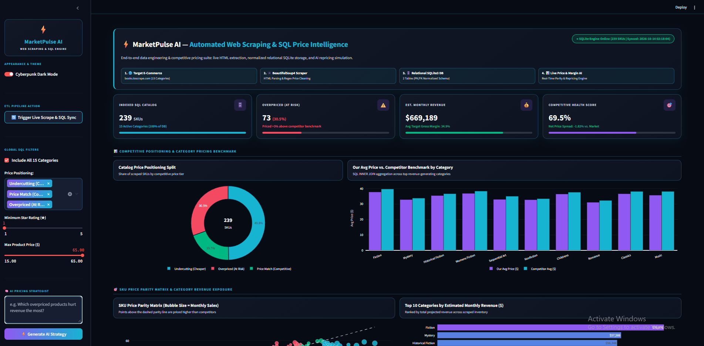
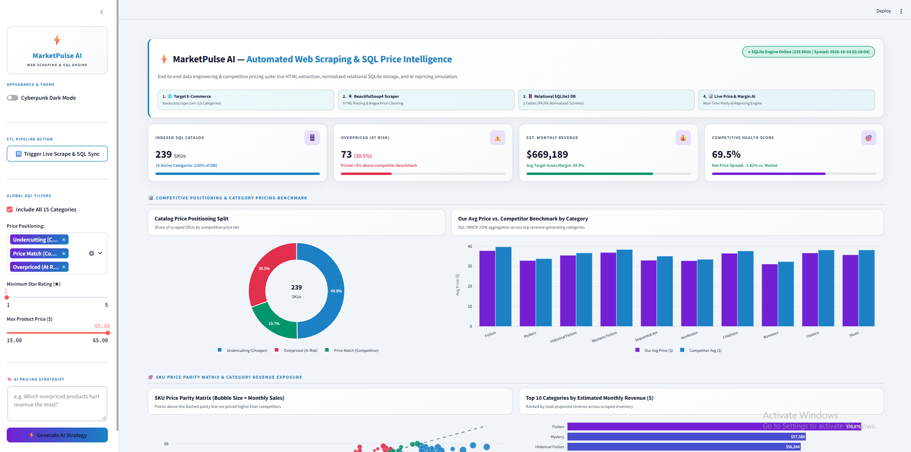

# ⚡ MarketPulse AI — Automated Web Scraping & SQL Price Intelligence

### Scrape. Store. Simulate. Protect Profit Margins.

[](https://python.org)
[](https://www.crummy.com/software/BeautifulSoup/)
[](https://www.sqlite.org/)
[](https://pandas.pydata.org)
[](https://streamlit.io)
[](https://plotly.com)

<br>

> **Blind pricing destroys e-commerce margins.**  
> MarketPulse AI automates competitor price tracking through a live **BeautifulSoup4 ETL pipeline**, stores normalized records inside a relational **SQLite3 database**, and empowers pricing teams with a **What-If Repricing Simulator** and **Live SQL Query Workbench**.

<br>

</div>

---

## 📸 Dashboard Preview

| Cyberpunk Dark Mode | Professional Light Mode |
|:---:|:---:|
|  |  |

> *Seamless one-click theme switching with 100% high-contrast CSS tokens.*

---

## ✨ Key Engineering & Business Features

| Feature | Description |
|:---|:---|
| 🕷️ **Automated Web Scraping ETL** | Extracts **239 SKUs across 15 categories** from `books.toscrape.com` using `requests` & `BeautifulSoup4`, with regex price cleaning and deterministic offline fallback |
| 🗄️ **Normalized Relational SQL Database** | Stores data in `market_intelligence.db` using a 2-table PK/FK relational schema (`categories` & `products`) |
| 🚀 **What-If Repricing Simulator** | Interactive elasticity engine that simulates automated markdowns (0%–20%) on overpriced SKUs and calculates recovered products & net monthly revenue impact |
| 💻 **Live SQL Query Workbench** | Built-in read-only SQLite studio with pre-loaded `INNER JOIN`, `GROUP BY`, and `HAVING` templates plus custom SQL execution |
| 🧠 **AI Pricing Strategist** | Sidebar assistant that audits the SQL catalog in real time and recommends targeted markdown strategies |
| 🌗 **Dual-Theme SaaS UI** | Custom Cyberpunk Dark Mode & Clean Light Mode with mini KPI progress bars and zero-overlap Plotly visualizations |

---

## 🏗️ Project Architecture

```text
Market-Intelligence-SQL-Scraper/
├── scraper_pipeline.py       # BeautifulSoup4 web scraper + SQLite3 database builder & verifier
├── market_dashboard.py       # Interactive Streamlit SaaS dashboard & Live SQL Workbench
├── market_intelligence.db    # Normalized SQLite relational database (auto-generated)
├── requirements.txt          # Python dependencies
├── dark_mode.png             # Dashboard preview (Dark theme)
├── light_mode.png            # Dashboard preview (Light theme)
└── README.md                 # Project documentation

```

---

## 🗄️ Relational Database Schema (`market_intelligence.db`)

| Table | Role | Columns |
| --- | --- | --- |
| **`categories`** | Dimension Table (`PK`) | `category_id` (PRIMARY KEY), `category_name`, `target_margin_pct` |
| **`products`** | Fact Table (`FK`) | `product_id` (PRIMARY KEY), `sku`, `title`, `category_id` (FOREIGN KEY), `our_price`, `competitor_price`, `price_diff_pct`, `price_status`, `rating`, `stock_quantity`, `est_monthly_sales`, `est_monthly_revenue`, `scraped_at` |

---

## 🚀 Getting Started Locally

### 1 · Clone the Repository

```bash
git clone [https://github.com/iamyhe/Market-Intelligence-SQL-Scraper.git](https://github.com/iamyhe/Market-Intelligence-SQL-Scraper.git)
cd Market-Intelligence-SQL-Scraper

```

### 2 · Install Dependencies

```bash
python -m pip install -r requirements.txt

```

### 3 · Run the Web Scraper & Build the SQL Database

```bash
python scraper_pipeline.py

```

### 4 · Launch the Interactive Dashboard

```bash
python -m streamlit run market_dashboard.py

```

---

**Built with ❤️ by [`iamyhe**`](https://github.com/iamyhe)

⭐ *If you found this data engineering & analytics project useful, give it a star!* ⭐